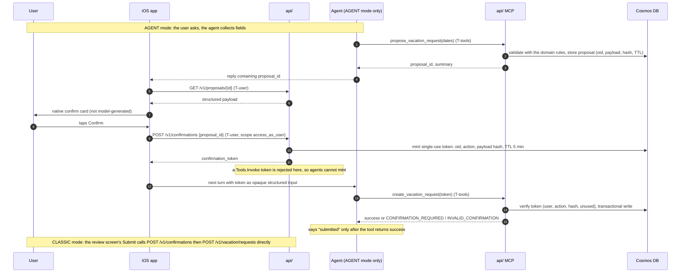
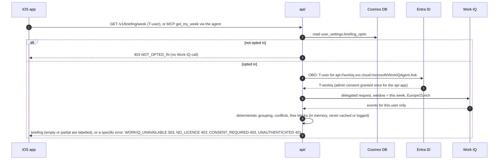

# Auth flows (Phase 2, proposal)

Sources: learn.microsoft.com/azure/foundry/agents/how-to/use-on-behalf-of-flow,
.../concepts/hosted-agent-permissions, .../how-to/tools/tool-authentication,
learn.microsoft.com/microsoft-365/copilot/extensibility/work-iq/permissions (retrieved 2026-10-17, preview features).
Decisions: ADR-002 (tokens), ADR-003 (roles), ADR-004 (Work IQ), ADR-005 (confirmation).

Tokens in play:

| Token | Audience | Held by | Used for |
|---|---|---|---|
| T-user | `api://employee-api` (scope `access_as_user`) | iOS Keychain | REST calls and confirmations |
| T-foundry | `https://ai.azure.com` (workload, managed identity) | api/ | invoking the hosted agent; does not represent the user |
| T-tools | `api://employee-tools` (scope `Tools.Invoke`), from OBO | api/, then the agent for one request | agent calls to the MCP surface |
| T-graph | `https://graph.microsoft.com` (`User.Read`), from OBO | api/ only, in memory | the caller's own profile and manager, to fill the directory (ADR-010) |
| T-workiq | `api://workiq.svc.cloud.microsoft` (`WorkIQAgent.Ask`), from OBO | api/ only, in memory | Work IQ calls |

## Flow 1: sign-in and REST call

```mermaid
sequenceDiagram
    autonumber
    participant App as iOS app (MSAL)
    participant Entra as Entra ID
    participant API as api/ (REST)
    participant DB as Cosmos DB
    App->>Entra: interactive sign-in, scope access_as_user
    Entra-->>App: T-user (aud=employee-api, roles, scp)
    Note over App: tokens stored in Keychain only
    App->>API: GET /v1/vacation/balance (Bearer T-user)
    API->>API: validate iss, aud, signature, exp, scp, roles
    API->>DB: read as oid from T-user
    DB-->>API: data
    API-->>App: 200, or 403 FORBIDDEN if role/ownership fails
    Note over App,API: expired token: silent refresh, else re-sign-in; drafts kept locally, no write with a stale token
```

## Flow 2: agent turn

```mermaid
sequenceDiagram
    autonumber
    participant App as iOS app
    participant API as api/ (gateway)
    participant Entra as Entra ID
    participant F as Foundry hosted agent
    participant TB as Toolbox (MCP)
    participant MCP as api/ MCP
    App->>API: POST /v1/agent/vacation/turns (Bearer T-user, history, X-Task-Run-Id)
    API->>API: validate T-user, rate limit, size limit
    API->>Entra: OBO: T-user for scope Tools.Invoke
    Entra-->>API: T-tools
    API->>Entra: managed identity token for https://ai.azure.com/.default
    Entra-->>API: T-foundry
    API->>F: Responses call, store=false<br/>Authorization T-foundry<br/>x-client-api-access-token T-tools<br/>x-ms-user-identity oid
    F->>F: check workload permission to represent the user
    F->>TB: tool call
    TB->>MCP: MCP request with T-tools
    MCP->>MCP: validate aud, scp=Tools.Invoke, role for tool
    MCP-->>TB: result (marked untrusted)
    TB-->>F: result
    F-->>API: streamed response, usage
    API-->>App: SSE stream; records agent_run (tokens, tool calls, cost)
```

The agent never sees T-user. T-foundry authorizes the call but carries no user permissions.
`api/` needs Foundry Agent Consumer plus the custom data action `UserIdentityImpersonation`, or `x-ms-user-identity` returns 403.
How T-tools reaches the MCP call (header forwarding vs a toolbox connection with `user-entra-token`/`oauth2`) is spike S-1/S-3.

## Flow 3: write confirmation (every write, both modes)



Replays (double tap, retry) hit the same deterministic document id derived from the token and return the existing result.

## Flow 4: weekly briefing and Work IQ



"Per-user consent" is the opt-in record plus the user's own sign-in; the Entra consent is tenant-wide and given once by an admin.

## Manual steps for the human (Entra and Azure)

Human-only per CLAUDE.md. I do not receive secrets. I will prepare exact commands for each step when its slice starts.

| # | Where | Action |
|---|---|---|
| 1 | Entra (Global Admin, via PIM) | Provision the Work IQ service principal (appId `fdcc1f02-fc51-4226-8753-f668596af7f7`) per the Work IQ API quickstart "enable your tenant". Skip if it already exists. |
| 2 | M365 admin | Decide and enable Work IQ billing for the 11 users. Learn pages disagree: Copilot Credits usage-based billing (Foundry page) vs a per-user M365 Copilot licence (quickstart page). Resolve in spike S-2. |
| 3 | App registrations | Create `employee-api` (single tenant): Application ID URI `api://<client-id>`; scope `access_as_user` (admins and users); app roles `Communicator`, `Manager`, `Employee` (allowed member type: Users); `requestedAccessTokenVersion: 2`; delegated permission Work IQ `WorkIQAgent.Ask` with **tenant-wide admin consent**. |
| 4 | App registrations | On `employee-api`: federated identity credential trusting the api's user-assigned managed identity (no client secret). Needed for OBO. |
| 5 | App registrations | Create `employee-tools` (resource app): scope `Tools.Invoke`; pre-authorize `employee-api`. Pending S-1 (may collapse into `employee-api` if self-OBO works). |
| 6 | App registrations | Create `employee-ios` (public client, iOS/macOS platform): redirect `msauth.<bundle-id>://auth` (bundle id: human supplies); permission `access_as_user`; grant admin consent; add it to `knownClientApplications` on `employee-api`. |
| 7 | Enterprise apps | On `employee-api`: **Assignment required = Yes**. Assign the 11 seeded users or groups: CEO = Communicator + Manager + Employee; 2 managers = Manager + Employee; 8 employees = Employee. |
| 8 | Azure RBAC (Foundry) | Create the custom role `Foundry Agent User Identity Impersonation` (data action `Microsoft.CognitiveServices/accounts/AIServices/agents/endpoints/UserIdentityImpersonation/action`, JSON in the hosted-agent-permissions page). Assign it and **Foundry Agent Consumer** to the api's managed identity at the Foundry account/project scope. |
| 9 | Azure RBAC (Foundry) | Foundry User for the project and agent identities at account and project scope. Foundry Project Manager for whoever creates toolbox connections. |
| 10 | Foundry (`azd ai`) | No toolbox connection for `comms` (S-3 resolved without one, ADR-002): the agent calls the api MCP itself with the forwarded token. Revisit only for tools that are not the api. |
| 11 | Handoff | Export the non-secret user attributes (manager, officeLocation or state, department) of the 11 users to `/Users/Shared/handoff/` (U-07). |
| 12 | Apple (not Entra) | Create an APNs auth key and upload it to the Notification Hubs namespace yourself. It never enters this session. |

No client secret is created anywhere in this design. If S-2 shows Work IQ needs one for OBO, stop and ask first.


## Implementation notes: comms agent (phase 6)
- Turn request: `POST /v1/agent/comms/turns {messages[], confirmation?}`. After the user taps Confirm on the card
  (`POST /v1/confirmations`, T-user), the app sends `confirmation {proposal_id, confirmation_token}`. `api/` loads
  the user's own unexpired proposal and gives the agent one fixed-format user message holding the token and the
  stored draft, so what is published is what was confirmed. A token-shaped but unknown value fails in
  `publish_announcement` (`INVALID_CONFIRMATION`).
- Confirm card content comes from `GET /v1/proposals/{id}` (proposer only, REST only), never from model text.
- The reply is structured (`kind`: message, clarification, proposal, published; `proposal_id`). `api/` downgrades
  `published` unless `publish_announcement` succeeded in that turn. The response also lists tool names and success.
- Audit (FR-AUTH-003): one content-free record per MCP call (user oid, tool, outcome, correlation id = `X-Task-Run-Id`
  or `X-Correlation-Id`), kept in memory and logged as `mcp_audit ...`. Tokens, arguments and text are never logged.
- Tool token path: `api/` sends `x-client-api-access-token`; the agent's ASGI middleware moves it into a context variable;
  the per-request agent's MCP client sends it as `Authorization: Bearer` to `API_MCP_URL`. `x-client-task-run-id` becomes
  `X-Task-Run-Id` on the MCP call, so the MCP audit record carries the task run as correlation id.
- Manual step 5 grows: define the three app roles on `employee-tools` and assign the same users or groups.
  Set `TOOLS_CLIENT_ID` (azd env) so `infra/` passes it to the Container App and `azure.yaml` builds the audience.

## Flow 4: directory lookup on first sign-in (ADR-010)

`api/` exchanges T-user for T-graph (OBO, delegated `User.Read`), then reads `GET /me` and `GET /me/manager`.
The exchange authenticates with the container app's user-assigned managed identity as a federated credential
on `employee-api` (no secret). The result is cached per user for a TTL. T-graph is never stored or logged, and
a failed exchange leaves the user unprovisioned (`NOT_PROVISIONED`) without breaking other calls, and is
not retried for that user for 60 s (`GRAPH_DIRECTORY_RETRY_SECONDS`), so a setup problem costs one Graph call, not one per request.
Sources: learn.microsoft.com/entra/identity-platform/v2-oauth2-on-behalf-of-flow,
.../entra/workload-id/workload-identity-federation-config-app-trust-managed-identity,
.../graph/api/user-get, .../graph/api/user-list-manager (retrieved 2026-10-19).

Human-only setup (run in your account, in this order; nothing here is a secret):

```
# 1. Let employee-api's token exchange use the container app's managed identity (no client secret)
az ad app federated-credential create --id <employee-api object id> --parameters '{
  "name": "api-managed-identity",
  "issuer": "https://login.microsoftonline.com/<tenant id>/v2.0",
  "subject": "<managed identity principal (object) id>",
  "audiences": ["api://AzureADTokenExchange"] }'

# 2. Delegated Graph User.Read on employee-api, consented tenant-wide so users are not prompted
az ad app permission add --id <employee-api client id> \
  --api 00000003-0000-0000-c000-000000000000 --api-permissions e1fe6dd8-ba31-4d61-89e7-88639da4683d=Scope
az ad app permission admin-consent --id <employee-api client id>

# 3. Turn it on and redeploy
azd env set GRAPH_DIRECTORY true
azd provision   # applies the setting; then: azd deploy api
```

Which Graph properties hold canton/store/region is tenant specific: set `GRAPH_CANTON_ATTRIBUTE`,
`GRAPH_STORE_ATTRIBUTE`, `GRAPH_REGION_ATTRIBUTE` if the defaults (`state`, `officeLocation`,
`preferredLanguage`) do not match your tenant.

## Deployment findings (first real run, phase 6)
Found while bringing `comms` up in the dev environment; each cost a failed turn.
- `TOOLS_CLIENT_ID` must be the **Application (client) ID of `employee-tools`**. It was set to another app's ID
  (`employee-ios`), which Entra answers with `invalid_resource` (log: `agent turn failed ... code=invalid_resource`).
  `az ad app show --id <id>` must show `identifierUris: ["api://<id>"]` and scope `Tools.Invoke`.
- The custom role **Foundry Agent User Identity Impersonation** is required. Foundry Project Manager and Foundry User do
  not include the data action, and the API got `foundry_403` until the custom role was created and assigned to the api
  managed identity (project scope). Project Manager is far more than the api needs; remove it once the turn works.
- `azd provision` used to reset the Container App to the placeholder image (the API answered with the "Your Azure
  Container Apps app is live" page). `infra/` now passes `SERVICE_API_IMAGE_NAME` back; if it is not set, run
  `azd deploy api` after every provision.
- A turn failure is logged as `agent turn failed: agent=<name> code=<code>` (no content). Codes: `managed_identity`,
  `invalid_client`/`unauthorized_client` (federated credential), `invalid_resource` (wrong tools app),
  `consent_required`/`invalid_grant`/`interaction_required` (consent), `foundry_403` (roles), `foundry_404` (agent name).
- The agent is deployed as source code (no Docker, no ACR build); ACR Tasks may be blocked on the subscription.

Flow 4 notes (phase 8, implemented in `api/app/briefing/`):
- The REST route holds an `access_as_user` token and the MCP tool a `Tools.Invoke` token. `MsalWorkIQClient` picks the confidential client of the app the token was issued for (by `aud`) and does the OBO from it, so **both** the API app and the tools resource app need `WorkIQAgent.Ask` admin consent (human, once). The tools app also needs its own **federated identity credential** for the Container App's managed identity (issuer `https://login.microsoftonline.com/<tenant>/v2.0`, subject = the identity's object id, audience `api://AzureADTokenExchange`); without it the agent path fails with `obo:invalid_client`. Verified end to end on the dev tenant 2026-10-20 (agent `get_my_week` returns the week). No client secret: both trust the container app's managed identity (federated credential).
- Work IQ 403 is split by its text: "Required scopes" is `CONSENT_REQUIRED` (administrator), any other 403 is `NO_LICENCE` (billing not enabled or no licence; Learn gives both causes one status). The user can fix neither in the app.
- Calendar is read one Zurich day per `call_function /me/calendarView?startDateTime&endDateTime` (`$top=100`, `$skip` is blocked by Work IQ): a day that fails, or has a `nextLink`, is reported as a missing day and the week is labelled partial. A failure about the account (consent, licence, token) on any day fails the whole week, never a half briefing.
- **Spike S-2 is not verified against the tenant**: the tool name and response shape follow the Learn pages; billing (Copilot Credits vs per-user licence) is still the human's decision.

## Tenant-wide directory (ADR-010 update): human-only steps
The api reads the tenant's employees with the container app's managed identity. Nothing below is done by the agent.
1. Find the managed identity's **object id** (the user-assigned identity's Overview page, not its client id) and the
   Graph service principal (`appId 00000003-0000-0000-c000-000000000000`). Then grant the two **application** roles
   (admin consent; Privileged Role Administrator or Global Administrator):
   ```
   MI=<object id of the managed identity>
   GRAPH=$(az ad sp show --id 00000003-0000-0000-c000-000000000000 --query id -o tsv)
   for ROLE in User.Read.All Application.Read.All; do
     ROLE_ID=$(az ad sp show --id 00000003-0000-0000-c000-000000000000 \
       --query "appRoles[?value=='$ROLE' && contains(allowedMemberTypes,'Application')].id | [0]" -o tsv)
     az rest -m POST -u https://graph.microsoft.com/v1.0/servicePrincipals/$MI/appRoleAssignments \
       -b "{\"principalId\":\"$MI\",\"resourceId\":\"$GRAPH\",\"appRoleId\":\"$ROLE_ID\"}"
   done
   ```
2. Assign the users to the `employee-api` enterprise application with their app role (Employee, Manager or
   Communicator). Only users holding a role are loaded. Group assignments are not expanded.
3. Check the three attributes hold the data (`GRAPH_CANTON_ATTRIBUTE` default `state`, `GRAPH_STORE_ATTRIBUTE`
   default `officeLocation`, `GRAPH_REGION_ATTRIBUTE` default `preferredLanguage`) and that managers are set.
4. `azd env set GRAPH_DIRECTORY_SYNC true`, `azd provision` (sets the app setting), `azd deploy api`.
5. Look for `directory sync employees=N active=N users_seen=N group_assignments_skipped=N` in the api log.
   `directory sync failed code=graph_users_403` means step 1 is missing or has not propagated yet.
To turn it off again: set the variable to `false` and remove the two role assignments.
